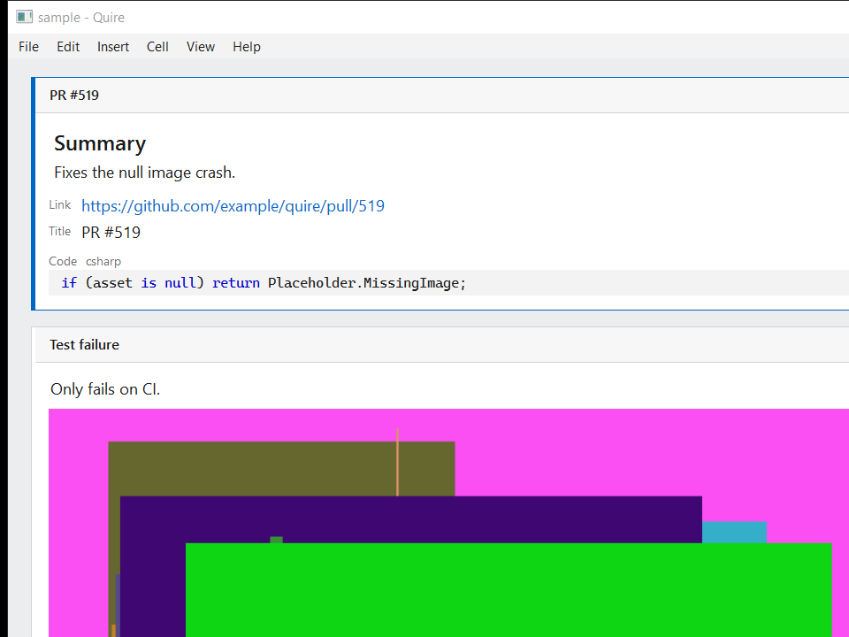
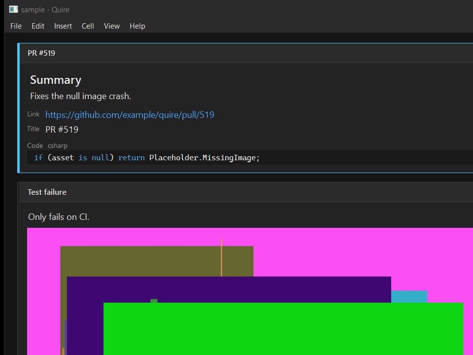
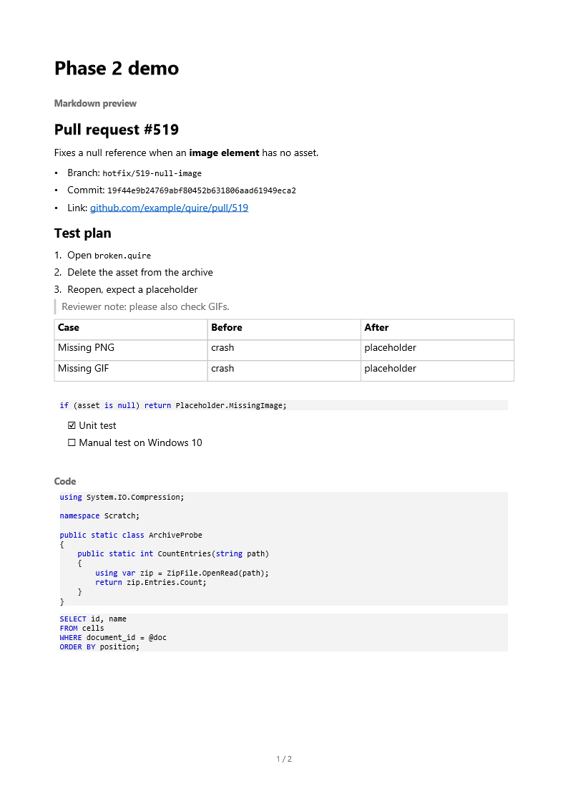

# Quire

**A native Windows scratchpad for everything that doesn't belong anywhere else.**

Commit SHAs, branch names, PR links, file paths, terminal output, screenshots, GIFs, half-written notes: Quire keeps them together in one document, organized into named cells, saved as one portable file, and exportable to Markdown, PDF, HTML or plain text.

<p align="center">
  
  
</p>

## Philosophy

Quire is built on a few deliberate choices. When a feature request pulls against one of them, the principle wins.

1. **Capture first.** Getting information in should take one keystroke or one drag. Paste a screenshot and it becomes an image. Drop a file and it becomes a reference. Organize later, or never.
2. **A cell holds anything.** A cell is a named container, not a content type. One cell can hold a heading, a paragraph, a screenshot, a link and a code block, in any order.
3. **The document is the interface.** No sidebars, ribbons, dashboards or floating toolbars. The page fills the window and everything else stays out of the way until asked for.
4. **Native, not web.** Quire is a WPF app that follows Windows: native dialogs, the system theme, high contrast, and per-monitor scaling. There is no browser engine inside.
5. **Local first.** Documents live on your disk. No accounts, no sync service, no telemetry.
6. **One file, nothing lost.** A `.quire` file is a ZIP holding a JSON manifest and the original image and attachment bytes. Copy it anywhere and everything comes along.
7. **Useful outside Quire.** Everything exports to formats other tools read, and the file format is documented and easy to inspect.
8. **Restraint.** Square corners, no gradients, no shadows, few icons. It should look like a careful Windows text editor, not a productivity suite.
9. **Not aggressive.** A commit SHA stays plain text. Quire only converts what is unambiguous: images, files, and a lone URL.

## Features

- **Mixed-content cells:** text, Markdown, code, links, images, animated GIFs, file references, embedded attachments and dividers.
- **Effortless capture:** paste images and files, drag and drop from Explorer or a browser, and a pasted lone URL becomes a link.
- **Markdown and code previews:** rendered Markdown (tables, task lists, links) and syntax-highlighted code until you click to edit the source.
- **Reliable storage:** atomic saves, document-wide undo and redo, crash-recovery drafts, and validation of every file before it loads.
- **Export:** Markdown with an assets folder, printable PDF with selectable text, self-contained HTML, and plain text.
- **Find** across cell names and every text field (Ctrl+F).
- **Themes:** light, dark, or follow Windows. High contrast is respected, and the title bar matches.
- Recent documents, zoom (Ctrl+wheel), full screen, and a keyboard shortcut for nearly everything (F1 lists them).

<p align="center"></p>

## Install

Download the latest release from the **Releases** page:

- `Quire-<version>-win-x64.zip` is self-contained. Unzip it anywhere and run `Quire.exe`. No .NET install is needed.
- `Quire-<version>-win-x64-framework-dependent.zip` is much smaller and needs the [.NET 10 Desktop Runtime](https://dotnet.microsoft.com/download/dotnet/10.0).
- `win-arm64` builds are provided for ARM devices.

Quire runs on Windows 10 and Windows 11 (64-bit). See [docs/COMPATIBILITY.md](docs/COMPATIBILITY.md) for what has been tested.

## Build from source

Requirements: Windows 10 or 11 and the [.NET 10 SDK](https://dotnet.microsoft.com/download/dotnet/10.0).

```
git clone <this repository>
cd quire
dotnet build Quire.slnx
dotnet test Quire.slnx
dotnet run --project src/Quire.App
```

Open a file directly with `dotnet run --project src/Quire.App -- path\to\notes.quire`.

### Building the executables

`tools/publish.ps1` builds the same files the releases contain:

```
./tools/publish.ps1
```

It writes zips and a `SHA256SUMS.txt` to `dist/`, and unzipped copies to `out/`:

| Build | Size | Runs on |
|---|---|---|
| `Quire-<version>-win-x64.zip` | ~60 MB single `Quire.exe` | Any 64-bit Windows 10/11 PC. The .NET runtime is bundled. |
| `Quire-<version>-win-x64-framework-dependent.zip` | ~3 MB single `Quire.exe` | PCs with the [.NET 10 Desktop Runtime](https://dotnet.microsoft.com/download/dotnet/10.0) installed |
| `...-win-arm64...` | same two variants | ARM64 Windows devices |

Options: `-Version 0.2.0` stamps a version (default: `Directory.Build.props`), `-Runtimes win-x64` limits the targets, and `-Variants SelfContained` or `-Variants FrameworkDependent` builds just one kind. The equivalent single commands are:

```
dotnet publish src/Quire.App -c Release -r win-x64 --self-contained -p:PublishSingleFile=true -p:IncludeNativeLibrariesForSelfExtract=true -p:EnableCompressionInSingleFile=true -o out/self-contained
dotnet publish src/Quire.App -c Release -r win-x64 --self-contained false -p:PublishSingleFile=true -o out/framework-dependent
```

### Publishing a release

Move the **Unreleased** notes in `CHANGELOG.md` under a new version heading, commit, then tag and push:

```
git tag v0.2.0
git push origin v0.2.0
```

The Release workflow tests, runs `tools/publish.ps1`, and publishes a GitHub release with the zips, checksums and that version's changelog section. A version with a suffix such as `v0.2.0-beta.1` becomes a pre-release. It can also be started by hand from the Actions tab.

## Using Quire

| Do this | How |
|---|---|
| New cell | Insert > Cell, or Ctrl+Shift+N |
| Add content to a cell | Insert menu, paste (Ctrl+V), or drag and drop |
| Rename a cell | Click its header, or F2 |
| Move a cell or element | Alt+Up / Alt+Down for cells, Alt+Shift+Up / Alt+Shift+Down for elements |
| Edit Markdown or code | Click the preview. Click elsewhere to see it rendered again. |
| Attach a dropped file instead of referencing it | Hold Ctrl while dropping, or change Insert > Dropped and Pasted Files |
| Find | Ctrl+F, then Enter / F3 for the next match |
| Export | File > Export |
| All shortcuts | Help > Keyboard Shortcuts, or F1 |

Unsaved work is written to `%LOCALAPPDATA%\Quire\Recovery` every 20 seconds. If Quire closes unexpectedly, the next launch offers to restore it. Settings and recent documents are kept in `%LOCALAPPDATA%\Quire\settings.json`.

## The `.quire` format

A ZIP archive (format version 1):

```
document.json   { "formatVersion": 1, "title": "...", "cells": [ { "id", "name", "elements": [ { "id", "type", ... } ] } ] }
assets/         Images and attachments, stored as their original bytes
```

Element types and their fields:

| Type | Fields |
|---|---|
| `text`, `markdown` | `text` |
| `code` | `language`, `text` |
| `link` | `url`, `title` |
| `image`, `gif` | `asset` (path inside the archive) |
| `attachment` | `asset`, `fileName` |
| `fileReference` | `path` (outside the document) |
| `divider` | none |

Unknown element types are preserved verbatim when saving, so older versions of Quire do not destroy content made by newer ones. Files from a newer format version are refused with a clear message instead of being misread. Older format versions go through a migration step per version.

## Project layout

```
src/Quire.App/
  Models/       Document, cells, elements and the asset store (no WPF types)
  Storage/      .quire read/write, recovery drafts, settings
  Editing/      Cell and element operations, undo, search, content recognition, syntax tokens
  Export/       Markdown, PDF, HTML and plain-text exporters (work from the model, never the UI)
  ViewModels/   Main view model, commands, change tracking
  UI/           Window, element templates, previews, GIF playback, themes
  Themes/       Styles and the light and dark palettes
tests/Quire.Tests/   xUnit tests
tools/publish.ps1    Builds the release executables
tools/gen_samples.py Generates throwaway test files into sample-docs/ (gitignored)
docs/                Specification, compatibility notes and screenshots
```

The design rule is that storage, export and editing logic operate on the document model only, so they can be tested without a window. The original product specification is in [docs/SPEC.md](docs/SPEC.md).

## Contributing

Contributions are welcome. Please read [CONTRIBUTING.md](CONTRIBUTING.md) and the [Code of Conduct](CODE_OF_CONDUCT.md) first. To report a security problem, follow [SECURITY.md](SECURITY.md) instead of opening a public issue.

## License

Quire is released under the [MIT License](LICENSE.txt).

It uses [Markdig](https://github.com/xoofx/markdig) (BSD-2-Clause) for Markdown and [PDFsharp/MigraDoc](https://github.com/empira/PDFsharp) 6.2 (MIT) for PDF export. PDFsharp is deliberately pinned to 6.2.x, because later versions are AGPL-licensed.
